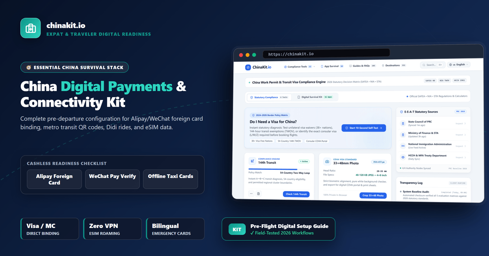
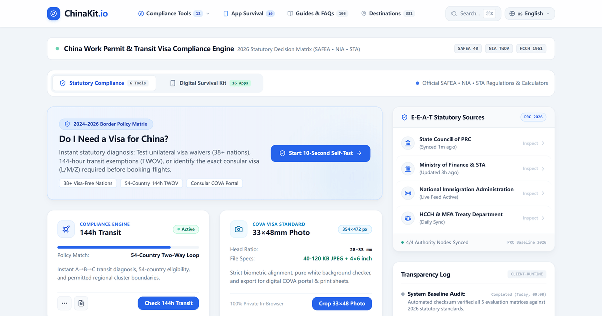
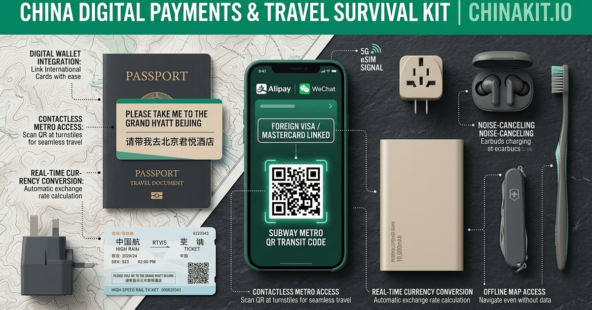

# ChinaKit MCP Server — China Inbound Travel, Visa, Meds, Tax & Payment Engine



## Overview & Production Architecture

**ChinaKit** ([https://chinakit.io](https://chinakit.io)) exposes a stateless, zero-authentication **Model Context Protocol (MCP)** server (`streamable-http` at `https://chinakit.io/api/mcp`) backed directly by TypeScript compliance engines covering China work-permit points, border medication screening, expatriate individual income tax (IIT), 240h/144h visa-free transit routing, Hague Apostille legalization, CAAC flight cabin lithium watt-hour rules, and 331 verified attraction guides. All 8 tools are public, deterministic, and annotated `readOnlyHint: true` with zero API keys required.



## Available MCP Tools (8 Read-Only Tools)

| Tool Name | Purpose & Deterministic Engine | Key Parameters | Safety |
| :--- | :--- | :--- | :---: |
| `calculate_china_work_permit_points` | Score an applicant under the China SAFIEA work permit rubric (Category A >=85, Category B >=60, Category C <60), detect 6x local average wage or  | `age`*, `education`*, `topUniversityGrad`, `workExperienceYears`* (+9 more) | `readOnly` |
| `check_china_customs_medication_legality` | Screen personal prescription drugs and over-the-counter remedies by English brand, generic ingredient, or Chinese alias against China Customs Cla | `medicationQuery`*, `categoryFilter` | `readOnly` |
| `calculate_china_expat_iit_and_bonus` | Simulate annual expatriate individual income tax liability in Mainland China comparing Seven Tax-Exempt Allowances (housing, schooling, home leav | `monthlyGrossSalary`*, `annualBonusRMB`, `bonusTaxTreatment`, `citySocialSecurityScheme` (+8 more) | `readOnly` |
| `validate_china_transit_and_visa_free_entry` | Inspect unilateral 15/30-day visa-waiver eligibility or 54-nation Transit Without Visa (TWOV) admissibility, verify A-B-C third-region flight com | `nationality`*, `originCountry`*, `transitPortCode`, `destinationCountry`* (+5 more) | `readOnly` |
| `query_china_document_apostille_steps` | Retrieve country-specific legalization workflows for background checks, diplomas, TEFL, and marriage certificates used in China visa filings, fla | `countryIso`*, `docTypeId`* | `readOnly` |
| `recommend_china_essential_apps_and_payment` | Search curated step-by-step setup guides for Alipay, WeChat Pay, Didi, 12306 rail booking, Amap navigation, and eSIM apps using foreign passports | `appSlugOrQuery`, `category` | `readOnly` |
| `lookup_china_destination_foreigner_guide` | Query verified attraction entry requirements across China cities (Beijing, Shanghai, Chengdu, Macau, etc.), returning turnstile passport scanning | `cityOrAttraction`*, `limit` | `readOnly` |
| `calculate_caac_powerbank_and_alipay_split` | Compute lithium battery watt-hours (mAh * V / 1000) against Civil Aviation Administration of China 100Wh/160Wh carry-on prohibitions AND split an | `capacityMah`*, `voltageV`, `paymentAmountRmb` | `readOnly` |

## Live JSON-RPC 2.0 Verification Sample

Request (`POST https://chinakit.io/api/mcp`):

```bash
curl -s -X POST https://chinakit.io/api/mcp \
  -H "Content-Type: application/json" \
  -d '{"jsonrpc":"2.0","id":1,"method":"tools/call","params":{"name":"calculate_caac_powerbank_and_alipay_split","arguments":{"capacityMah":20000,"voltageV":3.7,"paymentAmountRmb":480}}}'
```

Verified Production Response:

```json
{
  "powerbank": {
    "capacityMah": 20000,
    "voltageV": 3.7,
    "wattHours": 74,
    "caacStatus": "ALLOWED_UNRESTRICTED",
    "maxAllowedUnits": 2,
    "checkedBaggageAllowed": false,
    "caacRule": "Carry-on cabin luggage allowed without airline pre-approval (≤ 100Wh). Checked baggage is strictly forbidden; mAh/Wh label must remain clearly legible.",
    "toolUrl": "https://chinakit.io/tools/powerbank-calculator"
  },
  "alipayFeeOptimizer": {
    "totalAmountRmb": 480,
    "feeExemptionThresholdRmb": 200,
    "singleTransaction3PctFeeRmb": 14.4,
    "recommendedSplitTransactionsRmb": [
      200,
      200,
      80
    ],
    "splitTransactionFeeRmb": 0,
    "netFeeSavedRmb": 14.4,
    "toolUrl": "https://chinakit.io/tools/fee-splitter"
  }
}
```

## Quick Client Configuration (Claude Desktop / Cursor / Windsurf / Hermes)

```json
{
  "mcpServers": {
    "chinakit": {
      "type": "streamable-http",
      "url": "https://chinakit.io/api/mcp"
    }
  }
}
```

Or run directly in any Node.js terminal via the pinned official CLI:

```bash
npx -y chinakit-cli@1.0.0 tools
npx -y chinakit-cli@1.0.0 demo
```

## Domain Reference Specifications & Statutory Matrices

### Work Permit Category A/B/C City Wage Benchmarks (SAFIEA Matrix)

| City Tier | Representative Cities | Monthly Avg Wage (RMB) | 6x Direct Category A Annual Threshold (RMB) |
| :--- | :--- | :---: | :---: |
| **Tier 1 Mega (`tier1_super`)** | Beijing, Shanghai | ¥12,183 | **¥877,200 / yr** (¥73,100 / mo) |
| **Tier 1 (`tier1`)** | Shenzhen, Guangzhou, Hangzhou, Suzhou | ¥11,000 | **¥792,000 / yr** (¥66,000 / mo) |
| **Tier 2 (`tier2`)** | Chengdu, Wuhan, Xi'an, Qingdao | ¥8,500 | **¥612,000 / yr** (¥51,000 / mo) |
| **Other Regions (`other`)** | Haikou, Kunming, Dalian, Ningbo | ¥6,500 | **¥468,000 / yr** (¥39,000 / mo) |

### CAAC Aviation Lithium Battery & Alipay Foreign Card Thresholds

| Compliance Rule | Statutory Formula / Threshold | Operational Rule for Travelers |
| :--- | :---: | :--- |
| **CAAC Unrestricted Carry-On** | `Wh = (mAh * V) / 1000 <= 100 Wh` | Permitted in cabin baggage without pre-approval; checked luggage strictly prohibited |
| **CAAC Airline-Approved Carry-On** | `100 Wh < Wh <= 160 Wh` | Requires airline check-in approval; maximum 2 spare power banks per passenger |
| **CAAC Cabin & Train Ban** | `> 160 Wh` or unmarked capacity | Confiscated at airport security; strictly banned from aircraft cabin and cargo |
| **Alipay / WeChat Foreign Card** | `<= ¥200 RMB` per transaction | **0% international surcharge** (3% fee applies automatically above ¥200 single swipe) |

### Controlled Medication & Hague Apostille Quick Reference

| Subject | Critical Compliance Threshold | Source Engine / Statutory Trap |
| :--- | :--- | :--- |
| **Class I Psychotropic (Adderall / Ritalin)** | Maximum **7-day** personal supply | Must declare at Customs Red Channel with stamped English medical diagnosis |
| **Class II Psychotropic (Xanax / Zolpidem)** | Maximum **7-day** personal supply | Original pharmacy bottle with matching passport name required |
| **US FBI Identity History Summary** | Federal Apostille (**~25 days**) | **Trap**: State-level Apostille is rejected by Chinese PSB; requires U.S. Dept. of State |
| **Unilateral 15/30d vs 240h TWOV** | `FRA / DEU / KOR / AUS` vs `USA / GBR` | Unilateral waiver nations bypass A-B-C transit checks; TWOV strictly requires `A != C` |

## Technical Architecture & Editorial Reference



## Official Web Tools & Deep Documentation

- **[ChinaKit Official Portal — All-in-One Inbound Compliance Hub](https://chinakit.io)** — `https://chinakit.io`
- **[China Work Permit Category A/B/C Points Calculator](https://chinakit.io/tools/points-calculator)** — `https://chinakit.io/tools/points-calculator`
- **[China Customs Controlled Medication & ADHD Prescription Checker](https://chinakit.io/tools/meds-checker)** — `https://chinakit.io/tools/meds-checker`
- **[Expatriate China Individual Income Tax (IIT) & Fringe Optimizer](https://chinakit.io/tools/tax-calculator)** — `https://chinakit.io/tools/tax-calculator`
- **[China 240-Hour Visa-Free Transit (TWOV) & Airport Cluster Checker](https://chinakit.io/tools/transit-check)** — `https://chinakit.io/tools/transit-check`
- **[Hague Apostille & Consular Document Legalization Workflow Tool](https://chinakit.io/tools/document-checker)** — `https://chinakit.io/tools/document-checker`
- **[CAAC Flight Cabin Power Bank Watt-Hour Compliance Calculator](https://chinakit.io/tools/powerbank-calculator)** — `https://chinakit.io/tools/powerbank-calculator`
- **[Alipay & WeChat Pay ¥200 International Card Fee-Waiver Splitter](https://chinakit.io/tools/fee-splitter)** — `https://chinakit.io/tools/fee-splitter`

## License

MIT License — maintained by **[ChinaKit](https://chinakit.io)**.
